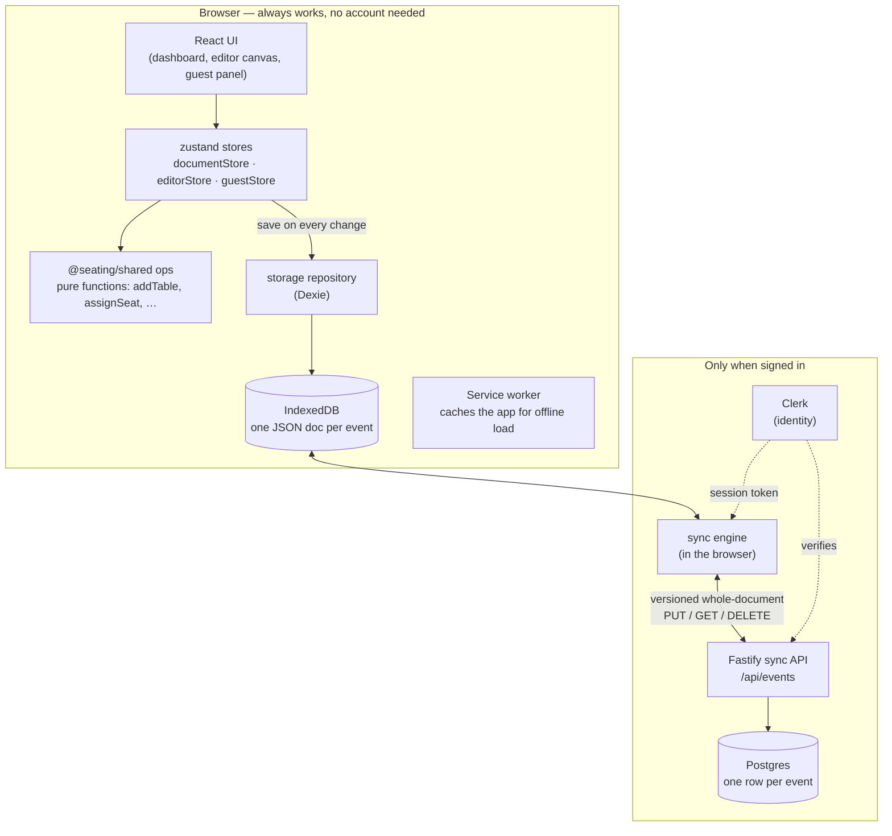
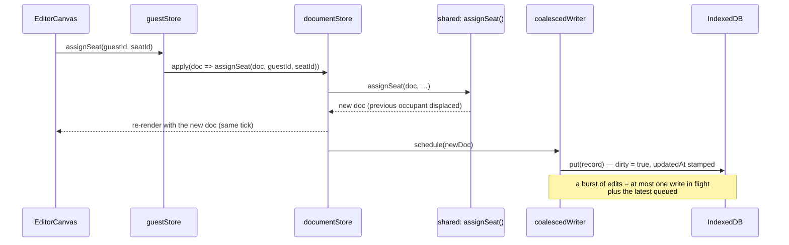

# Architecture

A guided tour of how the seating-chart app is built and how data moves through it. If you read one
doc, read this one. Then:

- [data-model.md](./data-model.md): the event document, where it's stored, how big it gets.
- [sync.md](./sync.md): the optional sign-in sync protocol and conflict policy.
- [project-structure.md](./project-structure.md): a file-by-file map.
- [styling.md](./styling.md): the Tailwind/DaisyUI theming system.

---

## The big picture: local-first

The app is **local-first**. The browser holds the real data, works with no network and no account,
and the server is an optional backup and sync service.

It's one product in three packages (an **npm-workspaces monorepo**):

| Package           | What it is                                                                                                                                                 |
| ----------------- | ---------------------------------------------------------------------------------------------------------------------------------------------------------- |
| `packages/shared` | **The contract.** The event-document zod schema and types, the pure edit operations, seat geometry, and the sync wire types. Imported by both web and API. |
| `apps/web`        | **The product.** React + Vite + react-konva. Everything a user does happens here, against IndexedDB.                                                       |
| `apps/api`        | **Optional sync service.** Fastify + Prisma + Postgres. Stores whole documents per account with optimistic concurrency. Not needed to run or use the app.  |

### Why local-first?

- **No barrier to entry.** Open the URL and start seating people. No sign-up, no server round
  trip, nothing to lose if the API is down.
- **Cheap to host.** The web app is static files (any CDN). A signed-out user costs nothing. The
  API only stores small JSON blobs for people who opt into sync.
- **It fits the data.** A whole seating chart is one small document (~91 KB for a 300-guest
  wedding), almost always edited by one person at a time. Storing it as one versioned document is
  simpler and sturdier than five relational tables with per-row endpoints.
- **Mobile-ready.** A future native app can reuse `@seating/shared` (schema plus ops) and the same
  six-endpoint sync API.

---

## How an edit flows

Follow one action, **dropping a guest onto a chair**:

1. **UI event.** `EditorCanvas` hit-tests the drop to find the seat.
2. **Store action.** `guestStore.assignSeat` calls `documentStore.apply(edit)`.
3. **Pure op.** `assignSeat` from `@seating/shared` returns a _new_ document, with any previous
   occupant moved out. It never mutates and never touches I/O.
4. **Instant UI.** The new document replaces the old one in memory, and React re-renders.
5. **Save.** The same document goes to the coalesced writer, which saves it to IndexedDB right
   away (milliseconds). A burst of edits (like typing a table name) coalesces: one write in flight
   and the latest one queued. Writes never reorder.
6. **Sync (if signed in).** The record is now `dirty`, so the sync engine pushes it about 1.5 s
   later (see [sync.md](./sync.md)).

There's no optimistic-update-then-reconcile with a server any more. The local write _is_ the
commit, which removes a whole class of bugs: rollbacks, temporary ids, half-saved table edits, and
guest lists racing each other.

---

## Client state

| Store / module    | File                                     | Owns                                                                                                                                               |
| ----------------- | ---------------------------------------- | -------------------------------------------------------------------------------------------------------------------------------------------------- |
| **documentStore** | `features/editor/store/documentStore.ts` | The open event document (tables + guests + assignments), its load status, and the local save status. **The single source of truth while editing.** |
| **editorStore**   | `features/editor/store/editorStore.ts`   | View state only: viewport, zoom/focus, selected tables. Table actions are thin wrappers over shared ops.                                           |
| **guestStore**    | `features/guests/store/guestStore.ts`    | Guest selection. Guest actions are thin wrappers over shared ops.                                                                                  |
| **storageStore**  | `features/storage/store/storageStore.ts` | Which IndexedDB database is active (signed-out or a specific account).                                                                             |
| **identityStore** | `features/auth/store/identityStore.ts`   | Who the data belongs to (Clerk user id, or null).                                                                                                  |
| **syncStore**     | `features/sync/store/syncStore.ts`       | Sync status for the badge, plus one-off notices.                                                                                                   |

Components read the document through tiny selector hooks
(`features/editor/hooks/useDocumentSelectors.ts`: `useTables`, `useGuests`, `useDimensions`, …).

Because tables and guests now live in the **same** document, the ops keep them consistent
themselves. Deleting a table unseats its guests in the same step, so the old effect that kept the
two stores in sync is gone.

## Routing

React Router (`App.tsx`):

| Path               | Component                                                                        |
| ------------------ | -------------------------------------------------------------------------------- |
| `/`                | `Dashboard`: live list of events in the active database (a Dexie `useLiveQuery`) |
| `/events/:eventId` | `EditorRoute`: opens the event on mount, saves and closes it on unmount          |
| `*`                | `NotFoundPage`                                                                   |

Static hosting must rewrite unknown paths to `index.html` (see README → Deploying). The service
worker does the same offline.

---

## The canvas (react-konva)

Unchanged by the local-first work.

- A **table** is a Konva `<Group>` at its center, containing the shape, the chair nodes and a
  label, so dragging or rotating the group moves everything together.
- The **viewport** (pan/zoom) is applied to the whole `<Stage>`. The fit-to-view, zoom-to-table and
  clamp math is pure functions in `features/editor/geometry/viewport.ts`.
- **Coordinates:** the floor plan has its own units (e.g. 1600×1000).
  Screen = `world * scale + offset`.

> ⚠️ react-konva is sensitive to Vite's dependency pre-bundling. If the canvas crashes in
> `<StageWrap>` after installing a dependency: `rm -rf node_modules/.vite apps/web/node_modules/.vite`
> and restart the dev server (see CLAUDE.md → Gotchas).

---

## The API (optional sync service)

One feature module, `apps/api/src/modules/events/`:

- `event.routes.ts`: `GET/PUT/DELETE /api/events[/:id]`.
- `event.service.ts`: Prisma queries. Every write is a compare-and-swap on `version`.
- `event.schema.ts`: path/query validation. Bodies are validated with the shared `eventDocSchema`.

`lib/auth.ts` resolves the **owner id**: the verified Clerk user when `CLERK_SECRET_KEY` is set,
otherwise an `x-owner-id` header (keyless dev only). Every query is scoped by owner through the
`(ownerId, id)` primary key.

The API never edits documents. It stores versions and rejects stale writes. All the domain logic
lives in `@seating/shared` and runs in the browser.

---

## Identity (Clerk), now optional and currently off

> **Currently disabled.** Sign-in and sync only exist in builds made with `VITE_ENABLE_SYNC=true`
> (`features/auth/lib/authConfig.ts`). Without it, which is the default and what ships, there's no
> sign-in UI, Clerk is never downloaded (it's lazy-loaded), and the app makes no network requests.
> The table below describes builds with the flag on.

| Configuration                                                  | What users get                                                                                  |
| -------------------------------------------------------------- | ----------------------------------------------------------------------------------------------- |
| No keys                                                        | A purely local app. No sign-in UI, no network calls.                                            |
| `VITE_CLERK_PUBLISHABLE_KEY` (+ `CLERK_SECRET_KEY` on the API) | The app works signed out exactly as above. "Sign in to sync" adds backup and multi-device sync. |
| Keyless + `VITE_DEV_SYNC_OWNER=dev-user`                       | Dev only: always "signed in" as `dev-user` against a keyless local API.                         |

How it's wired:

- `main.tsx` calls `startAccountSession()` **before the first render**. That opens the right local
  database for the current (or last-known) identity and starts sync.
- `<AuthRoot>` mounts `<ClerkProvider>` around the app (no gate) plus `<ClerkIdentityBridge>`. The
  bridge pushes Clerk's user id into `identityStore` and registers `getToken` for `apiClient`'s
  `Authorization: Bearer` header.
- `identityStore` changes drive `accountSession.applyIdentity()`, which switches the database,
  moves signed-out events into the account on sign-in, and starts or stops the sync scheduler.

Clerk's modal and user menu are themed live to the active DaisyUI theme
(`features/auth/lib/clerkAppearance.ts` + `useClerkAppearance`). That part is unchanged.

---

## Offline

- **Data:** always local (IndexedDB), so editing never needs the network.
- **App shell:** `vite-plugin-pwa` precaches the built HTML/JS/CSS/icons, so the app loads with no
  network after the first visit, including deep links. It's installable to a home screen or
  desktop.
- **Durability:** `navigator.storage.persist()` is requested on first event creation, and
  installed apps are exempt from Safari's 7-day eviction. Backups can be downloaded and imported.
  Signed-in data is also on the server. See data-model.md → "Is local storage big enough?".

---

## Key design decisions (the "why")

- **One document per event.** It matches how the data is used (small, edited as a unit, one
  editor at a time) and makes offline, backup, duplicate and sync almost trivial.
- **Pure ops in `@seating/shared`.** All domain rules (one guest per seat, seat identity, unseating
  on delete) live in one tested place that a mobile app can reuse.
- **Client-generated UUIDs.** Nothing waits on a server to mint an id. That's what removed the
  `tmp-` seat-id hack.
- **Whole-document sync with "keep both" conflicts.** Simple, auditable, and it never loses an
  edit. Field-level merging can come later if real-time collaboration is wanted.
- **Database per identity.** Account data and signed-out data never mix on a shared browser.
- **Seat identity by index.** Chair edits reuse seat ids, so seated guests stay put. (Same rule as
  before, now enforced in shared ops instead of the API.)
- **Layout-only duplication by default.** Copying guests and assignments is opt-in.
