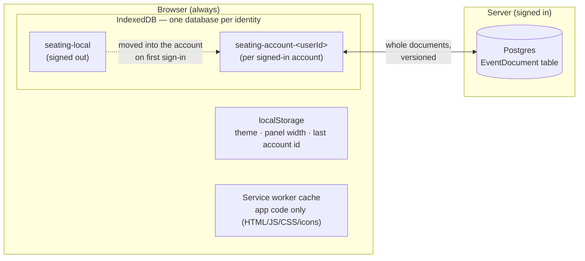
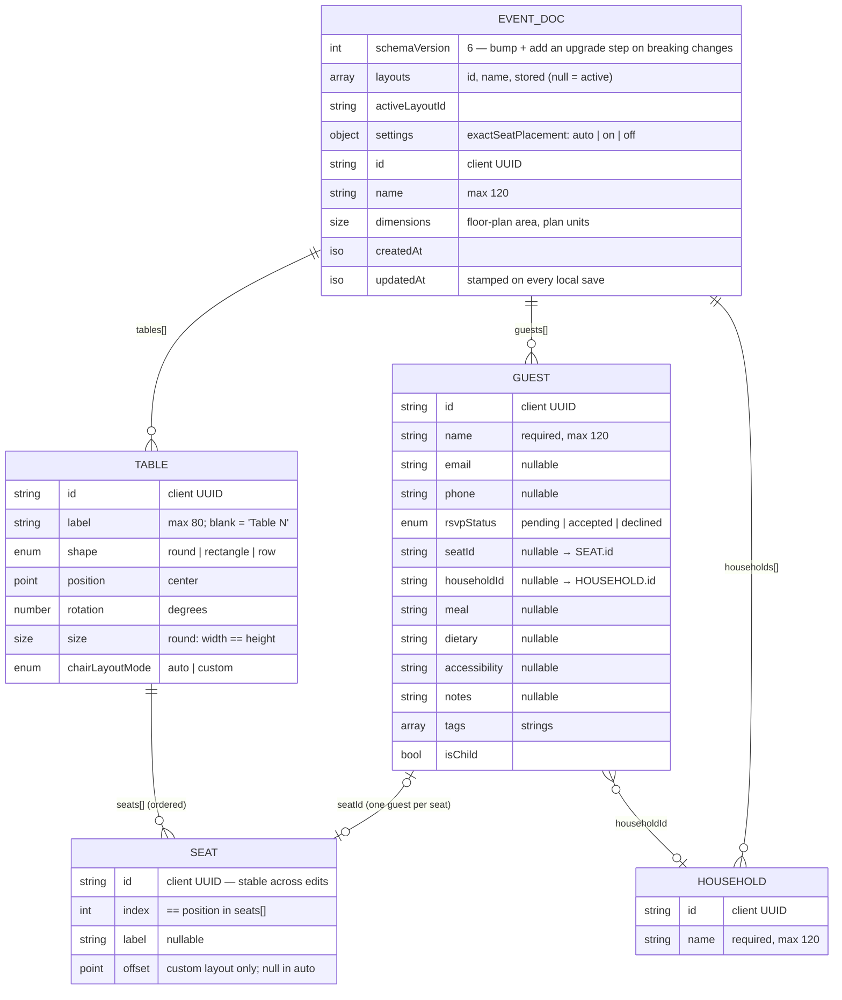

# Data model & storage

How a seating chart is shaped, where it's stored, and how much space it takes. For how the app
uses it, see [architecture.md](./architecture.md). For how copies are kept in step across devices,
see [sync.md](./sync.md).

---

## The one-sentence version

**Each event is one JSON document.** The browser keeps it in IndexedDB. If you sign in, the same
JSON is copied to one row in Postgres. Nothing else is stored anywhere.

---

## Where data lives



| Store                      | What's in it                                                  | Who can see it                         |
| -------------------------- | ------------------------------------------------------------- | -------------------------------------- |
| `seating-local` (IDB)      | Events made while signed out                                  | Anyone using this browser              |
| `seating-account-<id>`     | That account's events (a full offline copy)                   | This browser, when signed in           |
| `EventDocument` (Postgres) | Signed-in users' events, one row each, plus delete tombstones | Only the owning account (API-enforced) |
| localStorage               | UI preferences and the last signed-in user id (no event data) | This browser                           |
| Service worker cache       | The built app, so it loads offline (no user data)             | This browser                           |

Why one database per identity: signing out, or a second person signing in on the same browser,
never mixes guest lists. Signing out keeps the account's database as an offline cache; it's only
shown again when that account signs back in.

---

## The event document

Defined once, as zod schemas, in
[`packages/shared/src/document/schema.ts`](../packages/shared/src/document/schema.ts). The
TypeScript types are inferred from those schemas, so the shape can't drift between the API and the
web app.



A trimmed example:

```json
{
  "schemaVersion": 3,
  "id": "8906dfcd-cdb8-4d14-b236-851298ba8da2",
  "name": "Sarah & Tom's Wedding",
  "dimensions": { "width": 1600, "height": 1000 },
  "tables": [
    {
      "id": "1f6c…",
      "label": "",
      "shape": "round",
      "position": { "x": 800, "y": 500 },
      "rotation": 0,
      "size": { "width": 120, "height": 120 },
      "chairLayoutMode": "auto",
      "seats": [
        { "id": "a41e…", "index": 0, "label": null, "offset": null },
        { "id": "77b0…", "index": 1, "label": null, "offset": null }
      ]
    }
  ],
  "guests": [
    {
      "id": "c2d9…",
      "name": "Ada Lovelace",
      "email": null,
      "phone": null,
      "rsvpStatus": "accepted",
      "seatId": "a41e…",
      "householdId": "5b0e…"
    }
  ],
  "households": [{ "id": "5b0e…", "name": "Lovelace household" }],
  "settings": { "exactSeatPlacement": "auto" },
  "createdAt": "2026-10-09T02:00:00.000Z",
  "updatedAt": "2026-10-09T02:16:03.568Z"
}
```

### Rules every document satisfies

Checked by `eventDocSchema` ([`integrity.ts`](../packages/shared/src/document/integrity.ts)) on
every API upload, sync download and backup import:

1. Table, seat and guest ids are unique within the document.
2. Each table's seats are ordered, and `index` equals the seat's position in the array.
3. A guest's `seatId` points at a seat that exists.
4. No two guests share a seat.
5. Household ids are unique, and a guest's `householdId` points at a household that exists.

The edit functions in `packages/shared/src/document/*Ops.ts` keep these true as they go. Deleting
a table, or lowering its chair count, unseats the affected guests in the same step, so there's no
separate cleanup pass. Likewise, a household whose last member leaves (or is deleted) is dropped
by the same op, so documents never carry empty households.

### Layouts

An event can have several layouts (ceremony, reception…) that share one guest list. The **active**
layout is the document's top-level `dimensions`, `tables` and each guest's `seatId`; every other
layout keeps its own copy in `layouts[i].stored`:

```json
"layouts": [
  { "id": "main", "name": "Reception", "stored": null },
  { "id": "9c1…", "name": "Ceremony", "stored": {
      "dimensions": { "width": 1600, "height": 1000 },
      "tables": [ … ],
      "seating": { "<guestId>": "<seatId>" } } }
],
"activeLayoutId": "main"
```

Switching layouts (`switchLayout`) packs the active one into `stored` and unpacks the target. Table
and seat ids are unique across all layouts. To read every layout (exports, cross-room stats), use
`layoutViews(doc)`.

### Settings

`settings` holds per-event preferences that travel with the document (backups, sync).
`exactSeatPlacement` decides what seating a group at a table does: `on` opens the seat-by-seat
placement dialog, `off` auto-fills open seats, `auto` (the default) means on for events with 2 or
fewer tables (`isExactSeatPlacement` in `eventOps.ts`).

### Households

A household (a family, a couple, a party) is a set of guests to seat together. Membership lives on
the guest (`householdId`). The `households` array only holds ids and names. Seating ops keep a
household's members in neighbouring seats and never split one unless told to
(`assignGuestsToTable(…, { splitHouseholds: true })`). The UI asks before any move that would leave
members at different tables. Import fills households from a "Household" / "Party" column, matching
names case-insensitively (including households already in the event).

### Seat identity (why seated guests stay put)

Guests point at seats by id. Every operation that changes chairs (toggling auto/custom, moving a
chair, changing the count) **reuses the existing seat ids by index** and only creates ids for new
seats. A guest in seat 3 is still in seat 3 after you resize the table or switch it to a custom
layout.

### Schema versions

`schemaVersion` is `7` (v2 households, v3 `settings`, v4 guest details, v5 layouts, v6 `units` +
the `row` shape, v7 room objects + floor-plan image). Plan units are centimetres. Room objects
(`objects`) and the floor-plan image reference (`backdrop`) belong to each layout; the image bytes
live in the `images` IndexedDB store, not in the document (or backups). When the shape changes in a way old documents don't
satisfy:

1. Bump `EVENT_DOC_SCHEMA_VERSION` in `schema.ts`.
2. Add an upgrade step to `UPGRADES` in
   [`migrate.ts`](../packages/shared/src/document/migrate.ts), e.g. `1: (doc) => ({ ...doc,
schemaVersion: 2, newField: default })`.

`parseEventDoc` runs those steps on anything read from outside: sync pulls and backup files. If a
document comes from a _newer_ app version, it's refused with "Update the app" instead of being
silently mangled.

Documents already **stored in IndexedDB** are upgraded once, when the database opens: the Dexie
database version follows `EVENT_DOC_SCHEMA_VERSION` (`SeatingDb.ts`), so a schema bump
automatically adds a Dexie version whose upgrade runs `upgradeEventDoc` over every stored document.
There's nothing extra to do per bump beyond the `UPGRADES` step. A document that can't be upgraded
is logged and left as it was, rather than stopping the database from opening.

---

## The local record (IndexedDB)

[`apps/web/src/features/storage/db/SeatingDb.ts`](../apps/web/src/features/storage/db/SeatingDb.ts):
a Dexie database with two object stores: `events` (keyed by `id`, indexed on `updatedAt`) and
`versions` (version history, indexed on `eventId` and `[eventId+createdAt]`). Its version is
`DATABASE_VERSION` = store layout × 100 + document schema version (currently 103), so changing
either upgrades every database once.

```ts
interface LocalEventRecord {
  id: string;
  doc: EventDoc | null; // null only for a pending-delete tombstone
  summary: EventSummary; // name + counts, so the dashboard never loads whole documents
  updatedAt: string; // mirrors doc.updatedAt
  sync: {
    baseVersion: number | null; // server version last reconciled with; null = never synced
    dirty: boolean; // local changes the server hasn't accepted yet
    deleted: boolean; // deleted here, delete not yet confirmed by the server
  };
  trashedAt?: string | null; // in the trash since (ISO); purged after 30 days
}

interface EventVersionRecord {
  id: string;
  eventId: string;
  createdAt: string;
  kind: "auto" | "named";
  label: string; // "Opened", "Autosave", "Before restoring …", or the user's name for it
  doc: EventDoc; // as it was; may be an older schema version, so parse before use
  summary: EventSummary;
}
```

**Trash** keeps the whole record; only `trashedAt` changes. **Versions** are local: they aren't
synced or put in backups, and they're deleted with their event. Automatic versions skip unchanged
content and keep the newest 50 per event; named versions are kept until deleted.

The `sync` block is meaningless while signed out, but it's kept up to date anyway. That way, events
made signed out upload correctly the moment you sign in.

## The server row (Postgres)

[`apps/api/prisma/schema.prisma`](../apps/api/prisma/schema.prisma):

| Column                    | Type        | Notes                                                        |
| ------------------------- | ----------- | ------------------------------------------------------------ |
| `ownerId`                 | text, PK    | Clerk user id. Composite primary key with `id`.              |
| `id`                      | text, PK    | The document's own client-generated id.                      |
| `name`                    | text        | Copied from `data.name` for listing.                         |
| `version`                 | int         | +1 on every accepted write. Used for compare-and-swap.       |
| `data`                    | jsonb, null | The whole EventDoc. Cleared to null on delete.               |
| `deletedAt`               | timestamp   | Set on delete. The row stays so other devices hear about it. |
| `createdAt` / `updatedAt` | timestamp   |                                                              |

Index: `(ownerId, updatedAt)`. Because the primary key includes `ownerId`, one account can never
read or overwrite another's row, even if they somehow used the same document id.

The server never looks inside `data` beyond validating it. It doesn't edit documents, merge them,
or query individual guests.

---

## Is local storage big enough?

**Yes, by a wide margin.** Measured with the real document builder (`JSON.stringify` of a fully
seated event):

| Event                                     | Document size |
| ----------------------------------------- | ------------- |
| 2 tables, 20 guests (a dinner)            | ~6 KB         |
| 30 tables, 300 guests (a big wedding)     | ~91 KB        |
| 100 tables, 1,000 guests (a gala)         | ~304 KB       |
| 500 tables, 5,000 guests (the hard limit) | ~1.5 MB       |

Browsers give each site far more than that: Chrome and Edge allow up to ~60% of free disk per
origin, Firefox up to ~10% of disk, and Safari roughly 1 GB before asking. Even 1,000 big weddings
(~90 MB) fit easily. The API accepts uploads up to 5 MB per document, so the hard caps (500 tables /
5,000 guests, enforced by the schema) stay well inside it.

**The real risk isn't size, it's eviction.** IndexedDB is "best effort" storage by default:

- **Safari** can delete a site's data after ~7 days without a visit (sites installed to the home
  screen are exempt).
- Any browser may evict under disk pressure, and users can clear site data.

What this PR does about it:

1. **`navigator.storage.persist()`** is requested when you create your first event
   ([`lib/persistentStorage.ts`](../apps/web/src/lib/persistentStorage.ts)).
2. **Installable app (PWA).** Installed apps are exempt from Safari's 7-day rule.
3. **Download / import backup** (`<name>.seating.json`) on every event card.
4. **Sign in to sync** (built, but switched off for now). The server copy survives anything that
   happens to the browser.

**When would we outgrow this?** Two cases:

- **Uploaded floor-plan images.** Those should be stored as separate blobs (IndexedDB locally, S3
  or R2 on the server) and referenced by id, not inlined in the document.
- **Many people editing the same event at the same moment.** Whole-document sync handles
  "different devices, occasionally overlapping" well (see [sync.md](./sync.md)). It doesn't do live
  multiplayer, which would need per-field merging (e.g. a CRDT such as Yjs).
