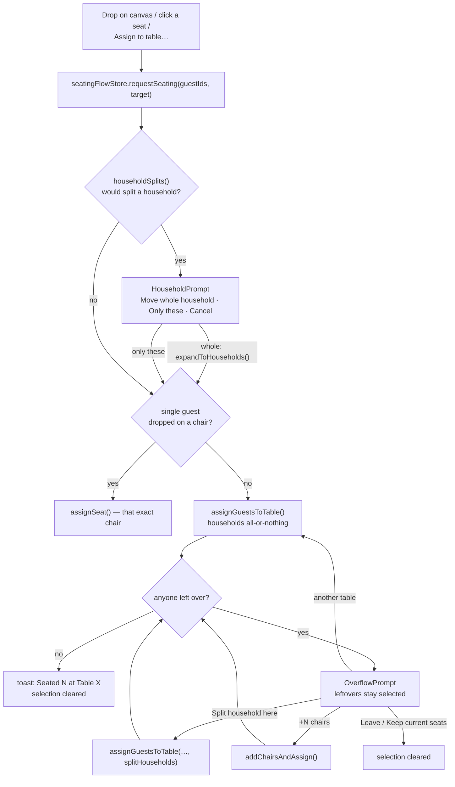

# Reviewing the seating workflow PR

A guide for auditing the PR for roadmap items 1–3:

1. **Bulk seating at the table level:** the overflow prompt, households, quick multi-select.
2. **Exact seat placement:** a per-event setting and a seat-by-seat placement dialog.
3. **Tablet & touch:** touch drag-and-drop, canvas gestures, drawers, 44px tap targets.

It covers what changed, the order to read it in, what to scrutinize, how to test it yourself, what
was and wasn't verified, and the decisions worth challenging.

> **Size:** about 4.6k lines added and 320 removed across 80 files. Without tests it's about 3.8k
> added. Tests add about 760.

---

## What a user notices

### Item 1: bulk seating

- **Leftovers no longer vanish.** Seat 5 guests at a table with 3 open seats: 3 are seated, the
  other 2 **stay selected**, and a prompt at the bottom of the canvas says _"2 guests didn't fit at
  Table 3 — pick another table"_. It lists every table with room and its open seats (green = all of
  them fit), plus **+N chairs at Table 3**, and **Leave unseated** (or **Keep current seats** if
  they were already seated). It repeats until everyone is placed or skipped.
- **Households.** Guests can belong to a household (family, couple, party):
  - the Unassigned list groups members under a ⌂ header;
  - clicking the header selects every member, and dragging it carries the whole household;
  - the header has rename and **Ungroup**;
  - selecting several guests offers **Group as household** / **Remove from household**;
  - import reads a **Household** or **Party** column.
- **Never split a household without asking.** Any move that would leave members at different
  tables first asks: _"Ada is in the Lovelace household… Move whole household (3) to Table 1 /
  Only Ada / Cancel"_. When filling a table, households go in whole or not at all. If one doesn't
  fit, the overflow prompt offers **Split household here** explicitly.
- **Selecting is visible.** Each guest has a checkbox where the initials used to be (tick to add or
  remove, no ⌘ needed). Household headers have one too (half-filled when only some members are
  picked), and the column header has select-all. Columns are labelled (Guest / RSVP).
- **Number fields** can be blank while you type and apply on blur or Enter, with −/+ buttons and no
  browser spinner.
- **Quick multi-select.** Shift-click selects a range (⌘/Ctrl+Shift extends). **Select next [8]**
  grabs the next batch of unassigned guests after the current selection, skipping declined ones.
- **Escape** closes an open seating prompt (the guests stay selected).

### Item 2: exact seat placement

- **A per-event toolbar switch, "Exact seat placement".** It shows an **auto** badge until you
  touch it: on for events with 2 or fewer tables, otherwise off.
- **With it on, seating several guests at a table opens a placement dialog** (after the household
  question, if any). It shows a live preview of that table's real chair layout, with the guests as
  chips. Tap a chip then a chair, or drag (mouse or touch). Taking an occupied chair asks first:
  **Swap** (if the mover came from a chair), **Replace** (the occupant goes back to "To place") or
  **Cancel**. **Confirm** applies everything as one change; **Cancel** changes nothing.
- Guests left without a chair stay selected under the overflow prompt, worded _"still need a
  seat"_, with the same table offered again.
- **Editing:** double-click (or double-tap) a table, or **Edit seating** in the properties panel,
  opens the same dialog prefilled. This works in either mode.

### Item 3: tablet & touch

- **Touch drag-and-drop:** press and hold a guest (or household header) for 350 ms, then drag onto
  a table. A quick swipe still scrolls the list. The table under your finger turns green.
- **Canvas:** pinch to zoom, two-finger pan, tap a table to select it, tap empty floor to
  deselect, double-tap a table to edit its seating.
- **Below 1280px wide (every iPad orientation):** the guest and properties panels become
  slide-over drawers, opened from toolbar buttons, with a backdrop. Starting a guest drag closes
  the guest drawer so you can see the canvas.
- **On touch screens every control is at least 44px.** The RSVP badge can be changed by tapping.

## The seating flow



Every document change here is a pure op in `@seating/shared`, applied through
`documentStore.apply`. `seatingFlowStore` only holds prompt state.

---

## Review order (commit by commit)

Each commit was made from a working tree that typechecked and linted, and the branch tip passes everything. Part 1 is commits 1–8 plus the docs. Parts 2 and 3 follow.

### 1. `feat(shared): households (schema v2) and household-aware table seating`

**Scrutinize. This is the contract.**

- `schema.ts`: `householdSchema` (id + non-blank name), `guest.householdId`, `households[]` capped
  at `MAX_GUESTS`. `EVENT_DOC_SCHEMA_VERSION = 2`.
- `integrity.ts`: household ids unique, and a guest's `householdId` must exist.
- `migrate.ts`: the `1 → 2` step (empty `households`, every guest `householdId: null`).
  `upgradeEventDoc` is now exported for the storage migration (commit 2).
- `householdOps.ts`: check that every op that can empty a household calls `pruneEmptyHouseholds`
  (`createHousehold`, `removeFromHousehold`, `dissolveHousehold`, and `removeGuest` in guestOps).
  - `householdSplits` defines what "splitting" means: some members move, and at least one other
    member is not already at the target table (unseated counts as "apart").
  - `expandToHouseholds` keeps a family contiguous (missing members go right after the first one
    picked).
- `guestOps.ts`:
  - `assignGuestsToTable` now builds **seating units** (a household's members in the group are one
    unit) and packs them greedily. A unit that doesn't fit is skipped, and smaller units after it
    still get seats. It returns `seatedIds` / `unseatedIds`. Guests who don't fit **keep their
    current seat**, unless the group needed that seat.
  - `openSeatIds`/`openSeatCount` were pulled out of it (seats held by the group count as open).
  - `addChairsAndAssign` grows the table by exactly the shortfall (capped at 64) via `setSeatCount`.
  - `addGuests` takes `household` names and matches existing households case-insensitively.
- `eventOps.ts`: `duplicateEventDoc` remaps household ids when guests are copied.

Tests: `householdOps.test.ts` (new) plus additions to `guestOps`, `schema` (v1 upgrade, missing
household) and `eventOps` tests.

### 2. `feat(web): upgrade stored events to the current schema on database open`

**Scrutinize. This is the one irreversible part.** This is the app's first schema bump, and local
reads (`getEventDoc`) never went through `parseEventDoc`, so existing events in IndexedDB would
have loaded without `households` and crashed. `SeatingDb` now declares
`version(EVENT_DOC_SCHEMA_VERSION).upgrade(upgradeStoredDocs)`. Dexie runs it once per database and
rewrites every stored doc through `upgradeEventDoc`.

- Future bumps get a storage migration for free (the Dexie version follows the schema version).
- A doc that fails to upgrade is logged and left as is, so one bad record can't brick the database.
- Test: `seatingDbUpgrade.test.ts` writes a real v1 record with a v1 Dexie database, then reopens
  it with `SeatingDb`.

### 3. `feat(web): seating flow with household check and overflow prompt`

- `guests/store/seatingFlowStore.ts`: read `requestSeating` → `seat` → `settle`.
  `placeOverflowAt` skips the household check on purpose: those guests already passed it, or the
  user chose "Only these".
- `guests/components/seating/*`: one component per file. `OverflowPrompt` hides itself when the
  selection no longer matches the leftovers (you clicked someone else). It doesn't offer a table
  where every leftover already sits, since that would be a no-op.
- `EditorCanvas.tsx`: drop and seat-click now just build a `SeatTarget` and call `requestSeating`.
- `AssignBar.tsx`: open-seat counts per table; household buttons.
- `guestStore.ts`: `assignGuestsToTable` moved out (to the flow). Added `selectRange`,
  `setGuestSelection`, household actions, and the Shift-click anchor.

### 4. `feat(web): households in the guest list, Shift-click ranges, select next N`

- `guests/lib/guestListModel.ts` (pure, tested): grouping, display order (which Shift-click ranges
  and "select next" use), and `nextUnassignedBatch`.
- `GuestList.tsx`, `HouseholdHeader.tsx`, `SelectNextControl.tsx`, `lib/selectModifiers.ts`.

### 5. `feat(web): import households from a Household / Party column`

- Aliases: `household`, `household name`, `party`, `party name`, `family`. **Header-only.** A
  headerless file's 4th column (often notes or meal) must not invent households.
- **Bug fix you should know about:** with a header row, columns it doesn't name used to be read by
  position anyway. A file with `Name,Party` put the party into `email`. Now only named columns are
  read when there's a header. Headerless files behave exactly as before.

### 6. Docs

`CLAUDE.md`, `data-model.md` (households, v2, storage upgrade), `architecture.md`,
`project-structure.md`, and this guide.

### 7–8. Follow-up from UX feedback

- `feat(web): NumberField …`: `components/NumberField.tsx` + `lib/numberInput.ts` (pure, tested)
  replace every `type="number"` input. Check `commit` only calls `onChange` on blur, Enter, arrows
  or −/+, never per keystroke. Before this, typing "12" chairs passed through 1 chair and unseated
  everyone in seats 2+. Blank → `min`, except table sizes, where blank keeps the current size
  (falling back to the 40-unit minimum would shrink the table).
- `feat(web): selection checkboxes and column labels …`: `SelectCheckbox` (stops propagation so the
  row's replace-selection click doesn't fire), `GuestColumnHeaders` (sticky, with select-all),
  `lib/guestColumns.ts` (the widths header and rows share). Household members are indented with
  padding inside the row instead of an indented list, so their RSVP column still lines up. The
  guest panel's default width went from 340 to 380px.
- `fix(web): steady selection bar, bigger checkbox targets`: `AssignBar` is always rendered at
  one height (controls disable when nothing is selected), so selecting never pushes the list down.
  `SelectCheckbox` now owns its cell: the full row height × 36px is the hit target, and the box is
  24px.

### Part 2: exact seat placement (4 commits)

#### `feat(shared): per-event exact seat placement setting (schema v3) and applySeatPlan`

**Scrutinize.**

- `schema.ts`: `settings.exactSeatPlacement`, plus the v2 → v3 step in `migrate.ts` (`"auto"`).
  Stored events pick this up automatically via the Dexie-version mechanism from part 1.
- `eventOps.ts`: `isExactSeatPlacement` (the "≤ 2 tables" rule lives here only; the web hook
  `useExactSeatPlacement` mirrors it for rendering).
- `guestOps.ts` → `applySeatPlan`: check how a contested seat resolves (the later entry wins; the
  earlier guest is unseated) and that someone not in the plan who sits in a planned seat is
  unseated.

#### `feat(web): pointer-based drag and drop (mouse, pen and touch)`

`features/dnd/`. Check `beginPointerDrag`:

- a press that never moves far enough stays a normal click;
- after a real drag, the next click is swallowed;
- with `touchDelayMs`, moving more than 8px before the timer cancels (that's a scroll);
- once active, `touchmove` is `preventDefault`ed so the page doesn't scroll under the finger.

Listeners are on `window`, so the source element may slide away mid-drag. There are no unit tests,
because web tests run in Node without a DOM. It was verified in the browser instead (see below).

#### `feat(web): placement dialog model and preview geometry (pure, tested)`

- `placementModel.ts`: the dialog never touches the document. `placementPlan` turns the working
  copy into seat changes.
  - A guest left in the tray who came from **another** table keeps that seat.
  - A guest taken **off this table** is unseated.
- `previewGeometry.ts`: chairs are spread uniformly when closer than 2.3 × the preview radius, so
  they stay tappable. Rotation is applied to positions, and labels stay upright.

#### `feat(web): exact seat placement dialog and per-event toggle`

- `seatingFlowStore`:
  - `seat()` opens the dialog when exact is on, except for a single guest dropped on a specific
    chair (already exact).
  - `confirmPlacement` hands leftovers to the overflow prompt.
  - In exact mode, `addChairsForOverflow` adds the chairs, then reopens the dialog.
- `PlacementDialog.tsx` and its pieces (one component per file). `useKeyboardShortcuts` ignores
  Delete/⌘D while the dialog is open, so you can't delete a table from behind the modal.
- `OverflowPrompt`: no "Split household here" in exact mode, since you split chair by chair in the
  dialog.

### Part 3: tablet & touch (4 commits)

- `feat(web): drag guests onto the canvas by touch …`: guest rows and headers use
  `beginPointerDrag` (350 ms hold on touch). The canvas registers the `canvas` drop zone. Its hover
  highlight is a `dragStore` subscription, so the canvas re-renders only when the target table
  changes. HTML5 DnD (`guests/lib/dnd.ts`) is removed.
- `feat(web): canvas touch gestures …`: `pinchViewport` (pure, tested) and `handleTouchMove` in
  `EditorCanvas`. A second finger stops any drag in progress. `Konva.hitOnDragEnabled = true` is
  set globally.
- `feat(web): side panels become slide-over drawers below 1280px …`: `layoutStore`,
  `useDrawerState` (closed = `inert`, except mid-drag), `DrawerBackdrop`, toolbar buttons. The
  guest panel's resizable width now goes through a CSS variable, so the drawer width can differ.
- `feat(web): 44px tap targets on touch screens …`: one `@media (pointer: coarse)` block in
  `global.css`, plus `pointer-coarse:` column widths in `guestColumns.ts`.

---

## How to test it yourself

```bash
npm run build:shared && npm run dev:web
```

1. **Migration:** open the app on a port where you already have events (5173 has your real dev
   data). They should open normally. In DevTools → Application → IndexedDB → `seating-local`, the
   docs show `schemaVersion: 3`, `households: []` and `settings: { exactSeatPlacement: "auto" }`.
2. Create an event, add two round tables (8 chairs each), and import a CSV like:

   ```csv
   Name,Email,Household
   Ada Lovelace,ada@x.com,Lovelace
   Byron Lovelace,,Lovelace
   Annabella Lovelace,,Lovelace
   Grace Hopper,,Hopper
   Walter Hopper,,Hopper
   Alan Turing,,
   Linus Torvalds,,
   Katherine Johnson,,
   Dorothy Vaughan,,
   Mary Jackson,,
   Ken Thompson,,Thompson
   Bonnie Thompson,,Thompson
   Corey Thompson,,Thompson
   Dana Thompson,,Thompson
   Evan Thompson,,Thompson
   ```

3. **Overflow:** set "Select next" to 10 and click it, then Assign to table → Table 1. 8 are seated
   (households whole), 2 stay selected, and the prompt appears. Click Table 2 in the prompt.
4. **Household kept whole + split offer:** click the Thompson header, ⌘-click the Lovelace header,
   and assign to the table with fewer seats left than 8. Thompson goes in, Lovelace is held back,
   and the prompt offers **Split household here** and **+N chairs**. Try both.
5. **Asking first:** click one Lovelace (just the row) and drag them onto a different table. The
   household question appears. Try **Only Ada** onto a full table: the overflow label reads **Keep
   current seats**.
6. **List:** Shift-click a range, ⌘-Shift-click to extend, rename a household (✎), Ungroup it, then
   select two guests and **Group as household**.
7. **Escape** closes a prompt; the selection survives.
8. **Exact placement:** make a new event with one table (the toggle shows **on · auto**). Tick a
   few guests and assign them. In the dialog, tap a chip then a chair, drag another chip, drag a
   guest onto an occupied chair (Replace / Swap), then **Cancel** (nothing changed) and try again
   with **Confirm**. Leave someone unplaced: they stay selected under "still need a seat".
9. **Editing:** double-click the table, or select it and use **Edit seating**.
10. **Toggle off:** assigning now auto-fills as in item 1.
11. **Tablet:** open DevTools device mode at iPad sizes (820×1180 and 1180×820). The panels are
    drawers. Open Guests, then press-and-hold a guest and drag onto a table: the drawer slides away
    and the table turns green. Pinch and two-finger-pan the canvas, and tap empty floor to
    deselect.
12. **Touch sizes:** at a touch-emulated size, every button is at least 44px and the guest list
    doesn't scroll sideways.

## What was verified

- `npm run lint`, `format:check`, `typecheck`, the `@seating/web` production build and
  `npm audit --audit-level=high` all pass. Tests: shared **64** passed, web **65** passed.
- In the browser (`web-keyless`, :5174): a real pre-existing v1 event was upgraded on open. Steps
  3–7 above all passed, and both stored documents passed `parseEventDoc` afterwards.
- **Item 2:** the following all passed:
  - tap-to-place and a real mouse drag in the dialog;
  - Replace (occupant → tray) and Swap (both seated);
  - Cancel leaves the document untouched, and Confirm saves in one change;
  - leftovers reach the overflow prompt;
  - the household question comes before the dialog;
  - double-click and "Edit seating" open it prefilled;
  - toggling off goes back to auto-fill.
- **Item 3:**
  - Touch drags were simulated with `PointerEvent`s (`pointerType: "touch"`): a quick swipe
    doesn't drag; press-and-hold drags with a ghost and a green target; the drop seats or asks.
  - Starting a drag from the drawer closes it; it goes inert afterwards.
  - A two-finger pinch was simulated with `TouchEvent`s on the Konva stage: about 1.9× zoom for
    about 1.9× spread, and it pans with the midpoint. Tap selects a table and tap on empty floor
    deselects.
  - Drawers were checked at 820×1180 and 1180×820. Desktop (1440) is unchanged.
  - With touch emulation (767px), every control measured at least 44px, the guest list has no
    sideways scroll, the dialog chairs render about 77px, and a touch drag inside the dialog moves
    a guest.
- Rolling back is safe for storage: Dexie 4 opens a database whose version is higher than the code
  declares (checked against fake-indexeddb), so the previous app still opens.

## What was not verified

- **API tests**: they need Postgres, and Docker wasn't running locally. CI runs them. The API only
  uses shared ops and the shared schema, so v2 flows through without API code changes.
- **Sync with mixed app versions** (sync is parked): a v1 client uploading to an API running this
  code is rejected (`schemaVersion` must be 3). A v1 client _pulling_ a v3 doc refuses it with
  "Update the app". Both are the intended behaviour, but untested end to end.
- **Real iPad hardware.** Everything touch was tested with emulation and synthetic events in
  Chromium. iOS Safari specifics weren't exercised on a device: the long-press callout
  suppression, `touchmove` cancellation during a drag, and `inert`. Please try it on an iPad.
- **Phone layout** is out of scope (roadmap item 15).
- **Rollback detail**: if you roll back to the old app _and edit_, guests it creates have no
  `householdId`. The Dexie upgrade won't re-run when you come forward again, so those documents
  would fail `parseEventDoc` on backup export. That's an edge case of downgrading, not fixed.

## Decisions worth challenging

1. **What counts as a split.** Moving some members of a household when any other member would end
   up at a different table _or unseated_ triggers the question. Seating a family one by one by
   dragging asks every time until they're all at one table. That's strict, but it's what "never
   split without asking" says. Item 2 (exact placement dialog) is the intended path for
   seat-by-seat work.
2. **Unseating (⤺) a household member doesn't ask.** It's an explicit single-guest action.
3. **Greedy packing skips a household that doesn't fit and seats smaller parties after it.** The
   alternative was to stop at the first unit that doesn't fit, which preserves order but wastes
   seats.
4. **"+N chairs" only appears for auto-layout tables.** `setSeatCount` re-spreads custom layouts
   evenly, which would silently undo hand-placed chairs. (The op itself works on custom tables; the
   UI hides it.)
5. **Leftovers keep their old seat.** When an already-seated group overflows a new table, the ones
   that don't fit stay where they were rather than being unseated.
6. **Import matches household names case-insensitively, including households already in the
   event.** Re-importing a sheet adds people to the existing "Lovelace" household. Two unrelated
   "Smith" families in one sheet would need different values (for example "Smith (Bob)").
7. **"Select next N" skips declined guests** and continues after the current selection (wrapping to
   the top). It doesn't round to household boundaries. A batch that cuts a household gets the
   household question when assigned.
8. **The Dexie version is tied to the schema version.** That's simple and self-maintaining. If the
   object stores themselves ever change shape, we'd want a separate storage version.
9. **A single click on a table still selects it; double-click opens seating.** The brief said
   "clicking a table with seated guests" opens the dialog. A modal on every click would make it
   impossible to select a table to change its chairs or size, so seating is on double-click /
   double-tap and the **Edit seating** button.
10. **The dialog is available in both modes** (via Edit seating / double-click). The toggle only
    decides what _assigning a group_ does.
11. **Unplaced guests after Confirm go to the overflow prompt** rather than silently staying
    unassigned, which matches item 1's "keep leftovers selected".
12. **Drawers start below 1280px**, so iPad landscape (1180) gets drawers too. Side-by-side panels
    there would leave about 540px of canvas. A 12.9" iPad in landscape (1366) gets the desktop
    layout.
13. **One-finger drag on empty floor still pans** (as on desktop). Two fingers pan and zoom.
14. **Touch drags need a 350 ms hold** in the guest list, so it can scroll. Inside the placement
    dialog they start on movement (nothing there scrolls).
15. **Our own pointer drag instead of dnd-kit.** It's about 150 lines, adds no dependency (new
    dependencies have caused Vite/react-konva cache trouble here before), and it lets one system
    span the guest list, the Konva canvas and the dialog.
