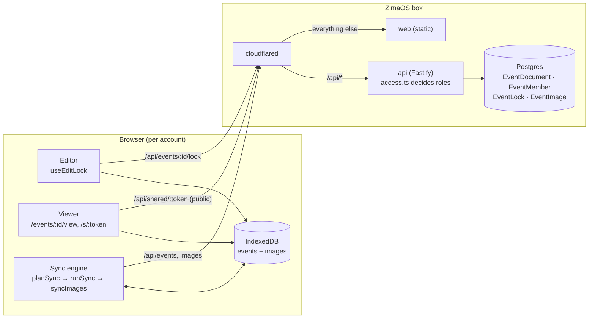

# Reviewing: sign-in, sync and sharing

A guide to auditing the `feat/sharing` PR: sign-in and multi-device sync turned on, plus sharing
(editors / viewers by email, a public read-only link, one editor at a time) and self-hosting on
the ZimaOS box behind a Cloudflare Tunnel.

Background docs: [sync.md](sync.md) (protocol, planner, sharing, lock), [hosting.md](hosting.md)
(deploy), [data-model.md](data-model.md) (tables).

## The shape of it



The browser stays the working copy. The server stores whole documents with a version number and
decides **who may read or write** each one. Nothing about the document format changed.

## Reading order

1. **Contract:** `packages/shared/src/sync/protocol.ts` (roles on the list, `idTaken`) and
   `sync/sharing.ts` (members, link, lock, images).
2. **Database:** `apps/api/prisma/schema.prisma` and the migration
   `20261103120000_event_sharing` (global event ids, the three new tables, a dedupe step).
3. **Who may do what:** `apps/api/src/modules/events/access.ts`, then `event.service.ts`
   (list = owned ∪ shared; viewers can't write; only owners delete).
4. **Sharing endpoints:** `modules/sharing/` (`sharing.service.ts`, `lock.service.ts`,
   `image.service.ts`, `shared.routes.ts` for the public link). Tests:
   `modules/sharing/__tests__/sharing.routes.test.ts`.
5. **Identity:** `apps/api/src/lib/auth.ts` (verified email from Clerk) and `config/env.ts`
   (refuses to start in production without Clerk).
6. **Client sync:** `apps/web/src/features/sync/engine/planSync.ts` (the new `planShared` rules),
   `runSync.ts`, `syncImages.ts`, `storage/repository/syncRepository.ts`.
7. **UI:** `features/sharing/` (Share dialog, `useEditLock`, `LockedEventView`,
   `SharedLinkRoute`), `editor/components/EditorRoute.tsx`, dashboard `EventCard`.
8. **Viewer** (merged from its own branch): `features/viewer/`.
9. **Hosting** (merged from its own branch): `docker/compose.yml`, `apps/api/Dockerfile`,
   `scripts/deploy-zima.sh --stack`, `docs/hosting.md`.

## What to scrutinize

- **Access control.** Every route should go through `accessFor` (or the owner check in
  `SharingService`). A stranger gets 404, never 403, so ids don't leak. The public link reads by
  token only and returns 404 when off, deleted or regenerated.
- **Invites by email.** They bind to whoever signs in with that **verified** primary email
  (`claimInvites`). If Clerk ever reported an unverified email as verified, that person would get
  access. Keyless dev trusts headers; production refuses to start without Clerk.
- **Global ids.** The primary key moved from `(ownerId, id)` to `id`. The migration deletes the
  older of any duplicate id before changing the key (only possible if two people imported the
  same backup; sync never shipped, so no real data is affected). After that, a stranger's create
  on a taken id gets `idTaken` and the client re-ids its copy.
- **Planner rules for shared events** (`planShared`): viewers never push; members never delete or
  restore the owner's copy; losing access with unsynced edits keeps them as "(copy)". These are
  the places most likely to lose or resurrect data, so the table tests in `planSync.test.ts` and
  `runSync.test.ts` are worth reading closely.
- **The edit lock is advisory.** It steers the UI only. Writes remain compare-and-swap, so a race
  (Edit anyway, offline edits) ends in a conflicted copy, never a silent overwrite. Check the
  renew/poll timers in `useEditLock` (30 s renew in any tab, 10 s poll while blocked, 90 s TTL).
- **Image uploads.** Raster MIME types only (SVG rejected: it can carry script and is served
  publicly), 15 MB each, 30 per event, write-once by id.

## Decisions worth challenging

- **Viewer page instead of a read-only editor.** Viewers, "Sam is editing" and public links all
  use the lightweight SVG viewer, not the Konva editor with controls disabled. Simpler and safer,
  but viewers can't use editor-only views (e.g. chair colouring by meal).
- **Sharing fields are optional on local records** (absent = owner) instead of an IndexedDB
  version bump. Avoids an upgrade; the cost is `recordRole()` at read sites.
- **No invite emails.** The owner tells people; they see the event after signing in with that
  address. Sending mail would need a provider.
- **Lock granularity is the whole event**, held per browser tab (two tabs of one person also
  block each other).
- **Version history stays local**, so each collaborator has their own.
- **Images stored in Postgres** (`bytea`), not object storage: fine at this scale, one less
  service on the box.

## How to test it yourself

```bash
npm run db:up
npm run build:shared
```

Then start the `api`, `web-devsync` (:5175, "dev-user") and `web-devsync-guest` (:5176, "Gina
Guest") previews from `.claude/launch.json`.

1. On :5175 open an event → **Share** → invite `guest-user@example.com` as _Can edit_. Turn on
   the read-only link.
2. On :5176 the event appears with "Shared by dev-user". Open it while :5175 has it open: it's
   read-only with "dev-user is editing". Add a table on :5175; it shows up on :5176 within ~10 s.
3. Click **Edit anyway** on :5176. Within 30 s :5175 says "Gina Guest took over editing".
4. Change Gina to _Can view_: her Open goes to the read-only view.
5. Open the link in another port (e.g. `web-keyless` :5174): the chart shows without sign-in.
   Turn the link off and reload: "This link doesn't work any more".
6. Remove Gina: the event disappears from her dashboard after the next sync.

## What was verified, and what wasn't

Verified locally:

- typecheck, lint, Prettier, all unit tests (shared, web: 268) and API integration tests (22,
  12 of them new, covering every role, the link, the lock and images);
- the full Playwright suite (188 passed; five iPad-landscape tests stalled on first page load
  while the machine was loaded and passed when rerun with one worker), including new specs for
  the viewer and for `/s/:token` with the API mocked;
- the steps above, by hand, with two keyless dev users;
- both Docker images build; the API image refuses to start in production without Clerk, and with
  a key returns 401 to an unauthenticated request.

Not verified:

- **Real Clerk sign-in and the Cloudflare Tunnel.** Nothing has been deployed; the production
  Clerk instance, DNS and tunnel are manual steps in `docs/hosting.md`.
- **Sharing end to end in CI.** The e2e build has no API, and keyless identities are baked in at
  build time, so a two-user Playwright run would need two extra builds plus Postgres in the e2e
  job. Covered instead by the API/unit tests and the manual run.
- Behaviour with many collaborators or very large documents.
