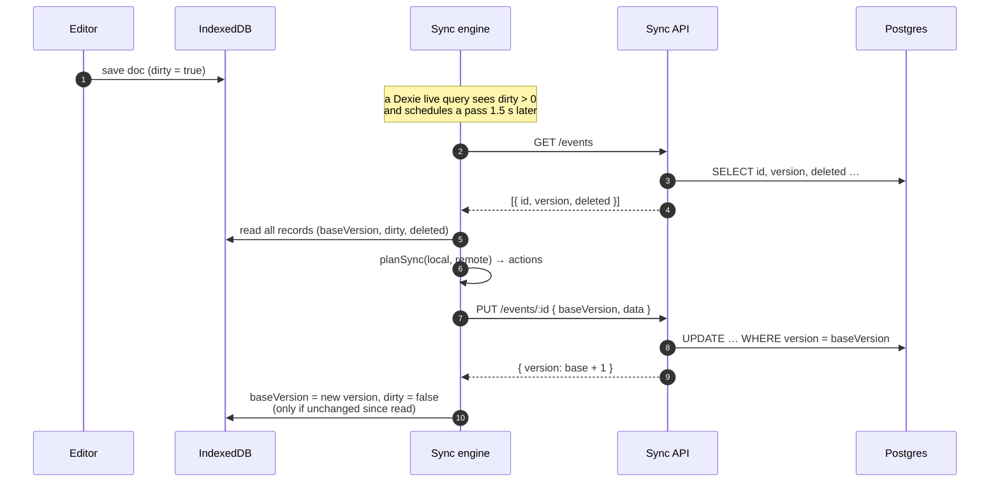
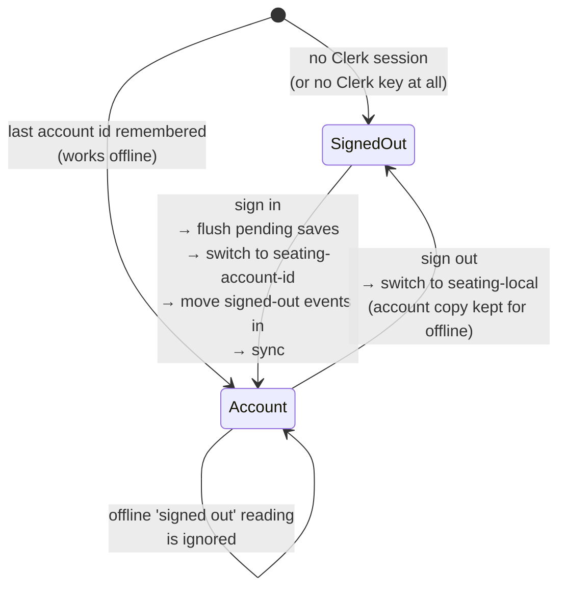

# Sync

How a signed-in user's events stay in step between this browser and the server (and so across
their devices). Signed-out use never touches the network; this whole doc applies only after
sign-in.

> Sync runs only in builds with `VITE_ENABLE_SYNC=true` (the public ZimaOS stack, see
> [hosting.md](hosting.md)). Other builds, like the LAN container, stay local-only.

The short version:

- The browser is always the working copy.
- The server stores whole documents, each with a `version` number.
- Every upload says which version it was based on, and the server only accepts it if that's still
  the latest (compare-and-swap).
- If two devices edit the same event before syncing, **both versions are kept**.

---

## The protocol

All endpoints live under `/api`. The caller comes from the Clerk session, and what they may do
with an event comes from their role (see [Sharing](#sharing)).
Request and response types are in
[`packages/shared/src/sync/protocol.ts`](../packages/shared/src/sync/protocol.ts).

| Method & path                      | Body / query                            | Success                                                                                                                               | Stale                                       |
| ---------------------------------- | --------------------------------------- | ------------------------------------------------------------------------------------------------------------------------------------- | ------------------------------------------- |
| `GET /events`                      | —                                       | `{ events: [{ id, name, version, deleted, updatedAt, role, ownerName, memberCount }] }` (yours and shared with you, incl. tombstones) | —                                           |
| `GET /events/:id`                  | —                                       | `{ id, version, deleted, updatedAt, data }`                                                                                           | 404 if unknown                              |
| `PUT /events/:id`                  | `{ baseVersion: number \| null, data }` | `{ id, version }`                                                                                                                     | **409** `{ current: { version, deleted } }` |
| `DELETE /events/:id?baseVersion=N` | —                                       | 204 (also if already gone)                                                                                                            | **409**                                     |

- `baseVersion: null` means "create". It's a 409 if the id already exists. If the id belongs to
  an event you can't see (two people imported the same backup), the 409 says
  `reason: "idTaken"` and your copy is given fresh ids and created again.
- A PUT lands only if the stored version still equals `baseVersion`. It's a single
  `UPDATE … WHERE version = $base` (see
  [`event.service.ts`](../apps/api/src/modules/events/event.service.ts)), so two racing writers
  can't both win.
- A PUT at a tombstone's current version brings the event back.
- `data` is validated with the shared `eventDocSchema`, so bad documents get a 400. Bodies are
  limited to 5 MB.

---

## One sync pass



[`runSync.ts`](../apps/web/src/features/sync/engine/runSync.ts) lists the server, reads local state,
calls the planner, and runs the actions. If anything had to be skipped because state moved
underneath it, it re-plans, up to 3 passes.

### When a pass runs

From [`accountSession.ts`](../apps/web/src/features/sync/engine/accountSession.ts):

- right after sign-in (and at startup, if already signed in);
- 1.5 s after the last local change (any record becomes `dirty`);
- when the window regains focus or the browser comes back online;
- every 60 s while the tab is visible, to pick up other devices' changes.

Only one pass runs at a time; requests during a pass fold into one follow-up pass
([`syncScheduler.ts`](../apps/web/src/features/sync/engine/syncScheduler.ts)).

---

## The conflict policy

All of it lives in one pure function,
[`planSync.ts`](../apps/web/src/features/sync/engine/planSync.ts), tested case by case in
`planSync.test.ts`. The guiding rule: **never lose an edit.**

`base` is the server version this browser last reconciled with. `v` is the server's version now.

| local ↓ / server → | `v == base` (unchanged) | `v != base` (someone else edited) | `v != base`, deleted elsewhere |
| ------------------ | ----------------------- | --------------------------------- | ------------------------------ |
| **clean**          | nothing                 | pull                              | drop locally                   |
| **edited (dirty)** | push at `base`          | **keep both** (fork, then pull)   | push at `v` (restores it)      |
| **deleted here**   | delete on server        | pull (their edit wins)            | drop locally                   |
| **not here**       | —                       | pull                              | nothing                        |

The server has never seen it: push as new, or drop it if it's a local tombstone.

**"Keep both"** means the local version is saved as a new event called
`"<name> (conflicted copy)"` with fresh ids. The server's version keeps the original id. Both end
up on every device after the next pass. The user decides which to keep, and nothing is merged
behind their back.

### Not clobbering the user mid-sync

Network calls take time, and the user may keep editing. Every local write the engine makes is a
**compare-and-set on the record's `updatedAt`**
([`syncRepository.ts`](../apps/web/src/features/storage/repository/syncRepository.ts)):

- A pull is only written if the record hasn't changed since the pass read it.
- After a push, the record is marked clean only if it hasn't changed since the pushed copy was
  read. Otherwise it stays dirty, and the newer edit goes up next time.
- A local drop only happens if the record is unchanged.

If a pull rewrites the event that's open in the editor, the editor reloads it. Pulls only happen
for events with no unsynced local edits, so in practice this is a change from another device
appearing while you watch.

---

## Identity and local databases



- **Signing in moves your signed-out events into the account**, so they sync. If the account
  already has the same id, the newer copy wins. A one-off notice says how many moved.
- The last account id is kept in localStorage, so the right database opens instantly, even offline
  or if Clerk can't load.
- While offline, a "signed out" reading from Clerk is ignored. Clerk can't refresh a session
  without the network, and switching databases would make your events look like they vanished.

---

## Status the user sees

| Badge                  | Meaning                                                                           |
| ---------------------- | --------------------------------------------------------------------------------- |
| _Saved on this device_ | The local save finished (always shown in the editor)                              |
| _(no sync badge)_      | Signed out. The "Sign in to sync" button is shown instead                         |
| **Synced**             | Up to date as of the last pass (hover for the time)                               |
| **Syncing…**           | A pass is running                                                                 |
| **Offline**            | Signed in but the API is unreachable. Edits are safe locally and will go up later |
| **Sync paused**        | The API rejected us (e.g. session expired). Hover for the reason                  |

---

## Trying it by hand

With `npm run db:up`, the `api` preview (or `npm run dev:api`) and the `web-devsync` preview
(keyless, syncing as `dev-user`):

```bash
# What the server has for dev-user
curl -s -H 'x-owner-id: dev-user' localhost:4000/api/events

# Pretend to be another device: fetch an event, change it, write it back at its version
ID=<event id from the list>
curl -s -H 'x-owner-id: dev-user' localhost:4000/api/events/$ID > /tmp/ev.json
python3 -c "import json;d=json.load(open('/tmp/ev.json'));doc=d['data'];doc['name']+=' (laptop)';print(json.dumps({'baseVersion':d['version'],'data':doc}))" > /tmp/put.json
curl -s -X PUT -H 'x-owner-id: dev-user' -H 'Content-Type: application/json' \
  --data @/tmp/put.json localhost:4000/api/events/$ID
```

Focus the browser tab and the open editor shows the new name. Run the same `PUT` again with the
old `baseVersion` and you get a 409. That's the compare-and-swap at work.

---

## Sharing

Every event has one owner. The owner can invite people **by email** as editors or viewers, and
turn on a **public read-only link**.

| Role   | Read | Write | Delete for everyone | Manage sharing | See who has access |
| ------ | ---- | ----- | ------------------- | -------------- | ------------------ |
| owner  | ✓    | ✓     | ✓                   | ✓              | ✓                  |
| editor | ✓    | ✓     |                     |                | ✓                  |
| viewer | ✓    |       |                     |                |                    |

- **Invites** are matched to an account by its **verified** primary email, the next time that
  person's app lists events. No email is sent; the owner tells them.
- **Public link** (`/s/:token`, API `GET /shared/:token`): 256-bit token, no sign-in, 60
  requests/min per IP, `no-store`. Off → 404; "New link" replaces the token.
- Endpoints: `GET/POST /events/:id/members`, `PATCH/DELETE /events/:id/members/:email`,
  `DELETE /events/:id/membership` (leave), `POST /events/:id/share-link`. Types in
  [`packages/shared/src/sync/sharing.ts`](../packages/shared/src/sync/sharing.ts).

### Shared events in the planner

These rules run before the table above when your role isn't owner:

| Situation                              | Action                                     |
| -------------------------------------- | ------------------------------------------ |
| You removed it from your list          | `leave` (the owner's copy is untouched)    |
| Viewer with local edits                | `forkThenPull` (never pushes)              |
| The owner deleted it                   | drop it, or `keepAsCopy` if you have edits |
| Missing from the list (access removed) | drop it, or `keepAsCopy` if you have edits |

`keepAsCopy` saves your unsynced edits as "<name> (copy)", your own new event, and tells you so.
Role, owner name and member count are refreshed every pass (`refreshAccess`), without counting as
an edit.

### One editor at a time

Simultaneous editing isn't supported, so a shared event has an advisory **edit lock**
(`PUT/GET/DELETE /events/:id/lock`, held per browser tab, 90 s lifetime):

- Opening a shared event takes the lock and renews it every 30 s; closing releases it.
- If someone else holds it, the event opens read-only ("Sam is editing"). That view syncs every
  10 s and switches to the editor as soon as the lock is free.
- **Edit anyway** takes the lock over. The previous editor finds out on their next renewal and
  drops to read-only; their saved changes still sync.
- Offline, or for an event nobody else can open, there's no lock.

The lock only steers the UI. Writes are still compare-and-swap, so if two people do edit at once
(Edit anyway, or offline), the second to sync gets a conflicted copy, as between your own devices.

### Floor-plan images

Backdrop pictures live outside the document, so they sync separately after it: pictures an event
uses go up once per event (`uploadedTo`) and come down when this device lacks them
(`PUT/GET /events/:id/images/:imageId`, raster types only, write-once). The public link serves
them too.

---

## Known limitations (deliberate, for now)

- **Whole-document granularity.** Two devices editing _different_ tables of the same event at the
  same time still produce a conflicted copy rather than a merge. Fine for "my phone and my laptop";
  not for live collaboration. Upgrade path: per-entity merge in the planner, or a CRDT (Yjs) if real
  multiplayer is ever wanted.
- **Tombstones are never purged.** Deleted rows keep `id`, `name` and `version` forever. That's
  cheap, but a cleanup job (e.g. purge after 90 days) would be tidy.
- **No simultaneous editing** (backlog). One editor at a time; see above.
- **Version history is local**, so collaborators each have their own.
- **Signing out doesn't delete the account's local copy** (so it works offline next time). On a
  shared computer you'd want a "remove from this device" option.
